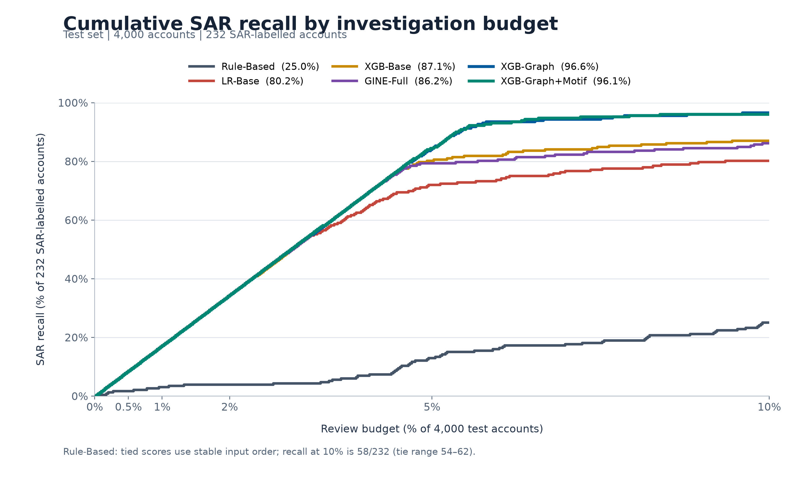
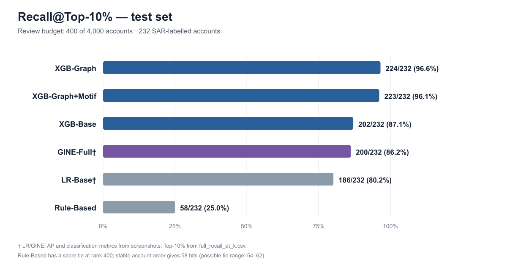

# 六个模型的测试集结果

测试集：4,000 个账户，其中 232 个 SAR 标注账户。Recall@Top-10% 统一按风险分数取前 400 个账户；与分类阈值无关。

| 模型 | AP | SAR Precision | SAR Recall | SAR F1 | Recall@Top-10% | 检出数 |
| --- | ---: | ---: | ---: | ---: | ---: | ---: |
| Rule-Based | 0.1377 | 0.1906 | 0.5776 | 0.2866 | 0.2500 | 58/232 |
| LR-Base† | 0.8015 | 0.8798 | 0.6940 | 0.7759 | 0.8017 | 186/232 |
| XGB-Base | 0.8879 | 0.9683 | 0.7888 | 0.8694 | 0.8707 | 202/232 |
| XGB-Graph | 0.9648 | 0.9761 | 0.8793 | 0.9252 | 0.9655 | 224/232 |
| XGB-Graph+Motif | 0.9657 | 0.9758 | 0.8707 | 0.9203 | 0.9612 | 223/232 |
| GINE-Full† | 0.8851 | 0.9733 | 0.7845 | 0.8687 | 0.8621 | 200/232 |

† LR/GINE 的 AP、SAR Precision、SAR Recall 和 SAR F1 来自保存的指标文件；Recall@Top-10% 与完整曲线来自 full_recall_at_k.csv。其余四行从包内预测文件重算 Top-10%，AP/Precision/Recall/F1 读取对应 metrics.json。

人工规则在第 400 名存在同分：第 400 名同分组共有 242 个账户，其中 11 个 SAR；高于该分数的 392 个账户中有 54 个 SAR。固定原始账户顺序取余下 8 个名额，检出 58 个；不同同分顺序下为 54–62 个。

