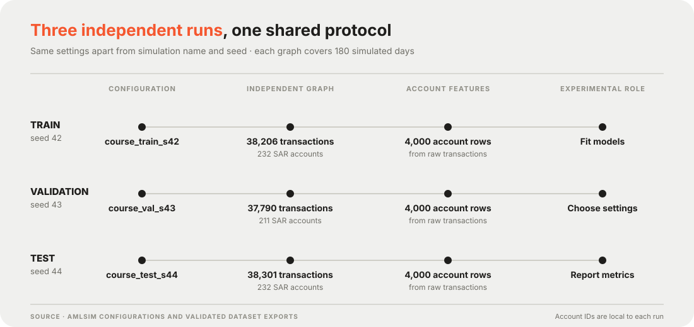
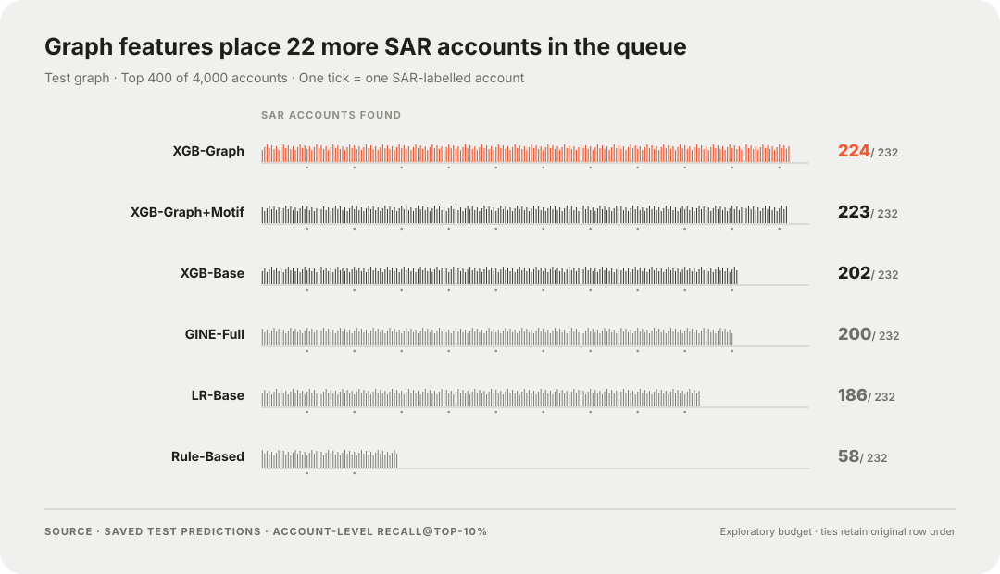

# Anti-Money Laundering on AMLSim

**Rules · Tabular ML · Graph Features · Graph Neural Networks**

Six account-level AML approaches, one common synthetic test graph, and a fixed investigation budget.

This project evaluates six approaches on synthetic transaction networks generated with AMLSim. The central question is whether engineered graph features improve an XGBoost model that already uses account and transaction summaries. We evaluate both binary classification and the ranking of accounts for a fixed-size investigation queue.

> **Scope:** SAR labels in this project are generated by a simulator. Results describe retrospective experiments on synthetic data, not real regulatory filings or performance in a production AML system.

| Independent graphs | Accounts per graph | Approaches compared | Best top-400 result |
| :---: | :---: | :---: | :---: |
| **3** | **4,000** | **6** | **224 / 232 SAR accounts** |

[Data generation](#data-generation) · [Models](#models) · [Results](#test-results) · [Reproducibility](#reproducibility-notes) · [Limitations](#limitations)

---

## Data generation

We ran AMLSim **three separate times**, rather than splitting accounts from one transaction graph. The train, validation, and test runs use seeds 42, 43, and 44, with otherwise matching settings. Account IDs are local to each run, so the same `acct_id` in two splits does not refer to the same account.



*Each lane is generated separately. The shared feature-building procedure produces one row per account; train fits models, validation selects settings and thresholds, and test supplies the reported results.*

| Setting | Value |
| --- | --- |
| Accounts | 4,000 per run |
| Observation window | 180 simulated days, starting 2017-01-01 |
| Normal behavior models | 960 per run: 160 each of single, fan-in, fan-out, forward, mutual, and periodical |
| Injected suspicious patterns | 30 per run: 10 each of fan-in, fan-out, and cycle |
| Pattern size | 5–10 accounts per pattern |
| Pattern transfer amount and duration | 100–1,000 and 5–20 simulated days |
| Transaction type | `TRANSFER` |

The exact simulator inputs are in [`configs/`](deliverables/amlsim_course_dataset_v1/configs/) and [`parameters/`](deliverables/amlsim_course_dataset_v1/parameters/). The exported account, transaction, alert, and SAR files are grouped by split under [`raw/`](deliverables/amlsim_course_dataset_v1/raw/). The checked dataset is also packaged as [`amlsim_course_dataset_v1.zip`](deliverables/amlsim_course_dataset_v1.zip).

| Split | Accounts | Transactions | SAR-labelled accounts | SAR rate |
| --- | ---: | ---: | ---: | ---: |
| Train | 4,000 | 38,206 | 232 | 5.80% |
| Validation | 4,000 | 37,790 | 211 | 5.28% |
| Test | 4,000 | 38,301 | 232 | 5.80% |

After simulation, [`build_account_features.py`](deliverables/amlsim_course_dataset_v1/scripts/build_account_features.py) aggregates transactions into one row per account in [`model_input/`](deliverables/amlsim_course_dataset_v1/model_input/). [`validate_dataset.py`](deliverables/amlsim_course_dataset_v1/scripts/validate_dataset.py) checks account and label counts, transaction IDs, positive amounts, and valid sender and receiver IDs; the recorded checks passed. See the [`validation report`](deliverables/amlsim_course_dataset_v1/validation_report.json) and [`SHA256 manifest`](deliverables/amlsim_course_dataset_v1/SHA256SUMS.txt).

To rebuild and validate the **account feature tables from the saved raw exports**, run from `deliverables/amlsim_course_dataset_v1/`:

```bash
python3 scripts/build_account_features.py
python3 scripts/validate_dataset.py
```

These commands do not rerun the AMLSim simulator. Recreating the transaction graphs requires the corresponding AMLSim version and dependencies, followed by separate simulator runs with the three supplied configurations.

## Dataset and evaluation

Models are fitted on train data. Validation data selects model settings or training checkpoints and the classification threshold that maximizes SAR F1. The independent test graph is used for the results below. Account IDs, alert fields, split identifiers, and labels are excluded from model features.

We report **average precision (AP)** for score ranking; **precision, recall, and F1** at each model's validation-selected threshold; and **Recall@Top-10%**, the fraction of the 232 test SAR accounts found among the 400 highest-scoring accounts. Recall@Top-10% does not use the classification threshold.

## Models

| Model | Inputs | Purpose |
| --- | --- | --- |
| Rule-Based | Four rolling transaction statistics | Explicit scoring baseline |
| LR-Base | 17 account and transaction summary features | Linear baseline |
| XGB-Base | The same 17 summary features | Nonlinear tabular baseline |
| XGB-Graph | Base features plus nine engineered graph features | Measure the value of network information |
| XGB-Graph+Motif | Graph features plus four flow and cycle motif features | Explore additional pattern features |
| GINE-Full | 17 node features and transaction amount, timing, and direction on edges | Edge-aware graph neural network comparator |

The three XGBoost variants share a hyperparameter configuration, though validation early stopping can select different numbers of trees. Comparisons across model families also reflect differences in inputs and training procedures.

## Test results



*Each tick represents one SAR-labelled account found in a model's top-400 queue. The chart uses ranking scores; the precision, recall, and F1 columns below use validation-selected classification thresholds.*

| Model | AP | Precision | Recall | F1 | Recall@Top-10% |
| --- | ---: | ---: | ---: | ---: | ---: |
| Rule-Based | 0.1377 | 0.1906 | 0.5776 | 0.2866 | 0.2500 |
| LR-Base | 0.8015 | 0.8798 | 0.6940 | 0.7759 | 0.8017 |
| XGB-Base | 0.8879 | 0.9683 | 0.7888 | 0.8694 | 0.8707 |
| **XGB-Graph** | **0.9648** | **0.9761** | **0.8793** | **0.9252** | **0.9655** |
| XGB-Graph+Motif | 0.9657 | 0.9758 | 0.8707 | 0.9203 | 0.9612 |
| GINE-Full | 0.8851 | 0.9733 | 0.7845 | 0.8687 | 0.8621 |

At a 400-account review budget, XGB-Graph finds **224 of 232** SAR-labelled accounts, versus **202 of 232** for XGB-Base. The increase is concentrated in fan-in and fan-out patterns. The motif variant has slightly higher AP, but finds one fewer SAR account in the top-400 queue; this small difference on one graph is not evidence of a reliable improvement.

The initially planned top-1% queue contains only 40 accounts, limiting recall to 40/232 (17.24%). All five learned models reach that ceiling. We added the top-10% comparison after observing this saturation, so it should be treated as exploratory.

## Reproducibility notes

The reported metrics were recalculated from saved per-account test scores. Every model's test prediction file contains 4,000 distinct accounts with labels matching the prepared test data. This checks the reported numbers against the saved predictions; it is not an independent retraining of all models.

For a faithful rerun, retain the three independent graph splits, fit preprocessing on train only, use validation for model and threshold selection, and evaluate the fixed configuration on test. Keep account IDs local to each split, and do not use simulator alert or SAR fields as input features. For equal risk scores in a review queue, the reported calculation preserves original row order; the Rule-Based top-400 result is sensitive to ties.

### Files at a glance

| Path | Contents |
| --- | --- |
| [`deliverables/amlsim_course_dataset_v1/`](deliverables/amlsim_course_dataset_v1/) | Dataset package and its own usage guide |
| [`configs/`](deliverables/amlsim_course_dataset_v1/configs/) and [`parameters/`](deliverables/amlsim_course_dataset_v1/parameters/) | AMLSim generation settings |
| [`raw/`](deliverables/amlsim_course_dataset_v1/raw/) and [`model_input/`](deliverables/amlsim_course_dataset_v1/model_input/) | Exported graphs and account-level features |
| [`results/`](deliverables/amlsim_course_dataset_v1/results/) | Saved LR and GINE predictions and metrics |

## Limitations

- The labels and injected patterns are synthetic, and every model observes the complete 180-day window. The results do not measure early warning or real-world detection.
- Model families use different representations and selection budgets. Their scores do not isolate the effect of model architecture.
- The motif and rule experiments were explored after earlier test inspection. A preliminary GINE test run was also inspected before its training limit was changed. The comparison is exploratory, rather than a fully untouched blind evaluation.
- A new graph evaluated after all choices are frozen, ideally across multiple seeds, is needed to assess how stable these findings are.

## Acknowledgment

This project uses [AMLSim](https://github.com/IBM/AMLSim) to generate synthetic transaction data.
